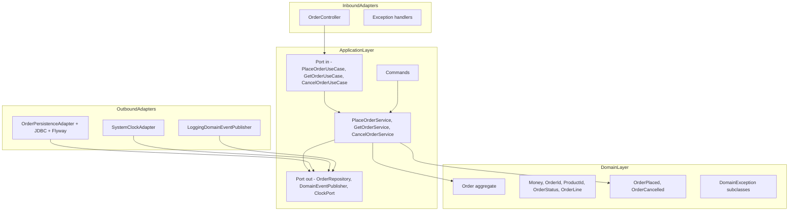
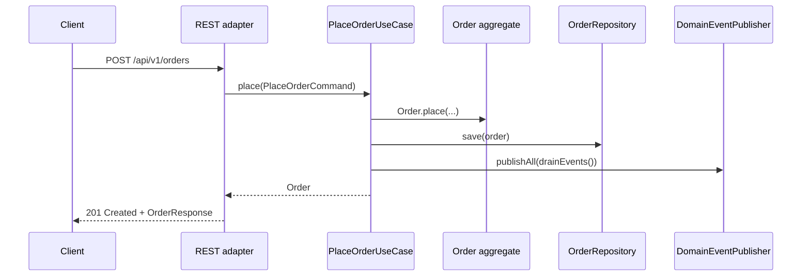

# Architecture

## Hexagonal / Ports and Adapters

## Dependency rule, enforced by ArchUnit

| From | May depend on | May **not** depend on |
|------|---------------|-----------------------|
| `domain` | JDK | `application`, `adapter.*`, any framework (`io.micronaut`, `jakarta.*`, `javax.*`, JDBC, Flyway, reactive libraries) |
| `application` | `domain` | `adapter.*`, framework DI/HTTP/validation/persistence libraries |
| `adapter.inbound.*` | `application`, `domain`, framework | `adapter.outbound.*`, other inbound adapters |
| `adapter.outbound.*` | `application`, `domain`, framework | `adapter.inbound.*`, other outbound adapters |
| `bootstrap` | `application`, `domain`, framework | Direct references between unrelated adapters (handled via DI) |

## Package layout

Base package: `com.enterprise.starter.order`.

| Package | Lives in module | Contains |
|---------|-----------------|----------|
| `domain.model` | `order-domain` | Aggregates and value objects (`Order`, `OrderLine`, `Money`, `OrderId`, `ProductId`, `OrderStatus`) |
| `domain.event` | `order-domain` | `DomainEvent` sealed interface and the `OrderPlaced`, `OrderCancelled` records |
| `domain.exception` | `order-domain` | `DomainException`, `OrderNotFoundException`, `InvalidOrderStateException` |
| `application.port.in` | `order-application` | Inbound ports (`*UseCase`) |
| `application.port.out` | `order-application` | Outbound ports (`OrderRepository`, `DomainEventPublisher`, `ClockPort`) |
| `application.command` | `order-application` | Transport-agnostic commands/DTOs |
| `application.service` | `order-application` | Use case implementations |
| `adapter.inbound.rest` | `order-adapter-rest` | REST controller, request/response DTOs, exception handlers |
| `adapter.outbound.persistence` | `order-adapter-persistence` | JDBC repositories, mapped-entity records, domain mapper, Flyway migrations |
| `adapter.outbound.time` | `order-bootstrap` | Default `SystemClockAdapter` |
| `adapter.outbound.eventing` | `order-bootstrap` | Default logging event publisher |
| `bootstrap` | `order-bootstrap` | `Application` main class and `UseCaseConfiguration` `@Factory` |

## Request lifecycle: placing an order

Virtual threads: the controller method runs on a Loom virtual thread (because
`micronaut.server.thread-selection=BLOCKING` and executors are configured
`virtual: true`), so JDBC calls inside the use case block *the virtual thread*,
not a precious platform thread.

## Error mapping

| Thrown in | Translated to |
|-----------|---------------|
| `OrderNotFoundException` | `404 Not Found` with `application/problem+json` |
| `InvalidOrderStateException` | `409 Conflict` with `application/problem+json` |
| Validation failure (`@Valid`) | `400 Bad Request` (Micronaut default) |

Adapters own this mapping; the domain never knows about HTTP.
